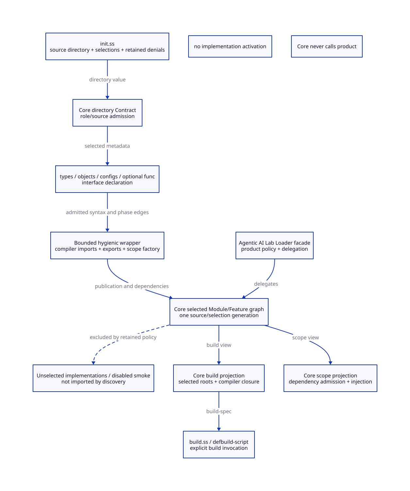
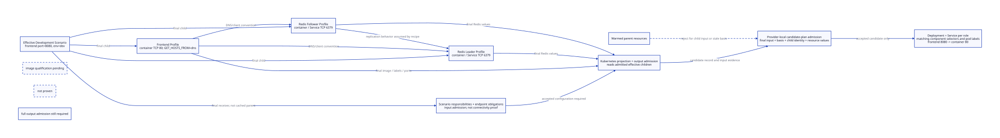

# SPDX-FileCopyrightText: 2026 tao3k team and Contributors
# SPDX-License-Identifier: Apache-2.0 AND LGPL-2.1-or-later

#+title: 11.24 Config Languages 23: Guestbook Effective Services and Resource Relationships
#+property: DOCUMENT_ID 11.24
#+date: [2026-10-16]
#+filetags: :config-language:kubernetes:guestbook:d2:design:
#+property: STATUS proposed-scheme-not-executed-no-loader-no-deployment

* Real baseline and purpose

This chapter continues the [[file:11.23-source-ref-to-admitted-scope.org][four-file module chain]], not a second Loader design.
The baseline is konfig commit 12025e8e250ca409006879126761c40e0eb0c0e0:
[[https://github.com/kcl-lang/konfig/blob/12025e8e250ca409006879126761c40e0eb0c0e0/examples/appops/guestbook/base/base.k][three-workload base]], [[https://github.com/kcl-lang/konfig/blob/12025e8e250ca409006879126761c40e0eb0c0e0/examples/appops/guestbook/dev/main.k][development image override]],
[[https://github.com/kcl-lang/konfig/blob/12025e8e250ca409006879126761c40e0eb0c0e0/models/kube/backend/server_backend.k][Server backend]] and [[https://github.com/kcl-lang/konfig/blob/12025e8e250ca409006879126761c40e0eb0c0e0/models/kube/mixins/service_mixin.k][Service mixin]]. These are inspected source, not a local
KCL execution or deployment result. Upstream licenses remain at the cited revisions.

The upstream frontend container listens on 80; both Redis containers and Services
use 6379. Frontend specifies GET_HOSTS_FROM=dns. It does not declare a typed
frontend-to-Redis connection object. The backend derives a component selector;
the Service mixin defaults its selector from the workload selector. Distinguish
these actual mechanisms from image-level DNS/client behavior that this source
alone cannot verify.

Actual KCL development override:

#+begin_src python
import konfig.models.kube.frontend

guestbookFrontend: frontend.Server {
    image = "gcr.io/google-samples/gb-frontend:v5"
}
#+end_src

This study adds a frontend Service port override and an environment label. Those
changes are our matched experiment, not claimed contents of upstream dev/main.k.
Keep actual Server-shaped input: mainContainer.ports and services[].ports are
separate fields. Do not replace them with a different abstraction and call it
syntax-equivalent to KCL.

* Directory init and module chain

The same init as module 22 selects this study; source is a Directory Source
value. Admission creates internal collections/SourceRefs, not user-written ones.

#+begin_src scheme
(yuanxu! mode: explicit source: "./modules"
  :infrastructure
  (kubernetes)
  :sandbox
  (nono-sandbox disable: #t)
  :custom
  (guestbook @ "./contributions/guestbook" -smoke))
#+end_src

JsonSchema is a required baseline dependency, not +json-schema. Guestbook publishes
its independent Profiles through its scope; Kubernetes owns rendering. Core owns
source/selection and scope/build projections. The product facade delegates to
these Core mechanisms. Retained disable/-smoke decisions apply to both views;
unselected implementations stay cold. Package-owned external roots require
source policy rather than filesystem guessing. The directory entry is pending.

* Published Profiles are independent of Module descriptors

The complete Profiles remain in [[file:11.21-jsonschema-guestbook-role-examples.org][module 20]]. Key unchanged declarations are:

#+begin_src scheme
(.def (FrontendProfile @ ServerDefaults.)
  name: "frontend"
  mainContainer:
  (.o name: "php-redis"
      env: (.o GET_HOSTS_FROM: (.o value: "dns"))
      ports: (list (.o containerPort: 80)))
  schedulingStrategy: (.o resource: TinyResource)
  services: (list (.o ports: (list (.o port: 80)))))

(.def (LeaderProfile @ ServerDefaults.)
  name: "redis-leader"
  image: "docker.io/redis:6.0.5"
  mainContainer: (.o ports: (list (.o containerPort: 6379)))
  schedulingStrategy: (.o resource: TinyResource)
  services: (list (.o ports: (list (.o port: 6379)))))

(.def (FollowerProfile @ ServerDefaults.)
  name: "redis-follower"
  image: "gcr.io/google_samples/gb-redis-follower:v2"
  mainContainer: (.o ports: (list (.o containerPort: 6379)))
  schedulingStrategy: (.o resource: TinyResource)
  services: (list (.o ports: (list (.o port: 6379)))))

(.def (GuestbookBase @ GuestbookScenario.)
  frontend: FrontendProfile
  leader: LeaderProfile
  follower: FollowerProfile)

(.def (GuestbookDefaults @ GuestbookBase)
  frontend: =>.+
  (.o image: "gcr.io/google-samples/gb-frontend:v3"
      replicas: 2
      labels: (.o app: "guestbook"
                  owner: "platform-v2"
                  costCenter: "infra")))
#+end_src

ServerDefaults. supplies replicas=1, workloadType=Deployment and an empty labels
object. TinyResource is defined once in module 20. The frontend base intentionally
requires an environment image; GuestbookDefaults reuses module 20's explicit V2 evolution experiment (image v3,
replicas=2 and maintained labels), not a claimed upstream KCL default. Profiles
can be reused in other Scenarios without inheriting Guestbook or a Module object.
Each .o inside a list constructs new Port/Service data, not an inherited override.

* User intent: replacement versus transformation

Target user code, within the bounded Guestbook scope from module 22:

#+begin_src scheme
(use-module (.get Modules custom guestbook) as gb
  (.def (Development @ (.get gb baseline))
    frontend.image: "gcr.io/google-samples/gb-frontend:v5"
    frontend.labels.env: "dev"
    frontend.services:
    (list (.o ports:
           (list (.o port: 8080 targetPort: 80 protocol: "TCP"))))))
#+end_src

Image and env are assignments. The Service list is deliberately replaced: the
user wants precisely one published 8080 endpoint, not every future upstream
Service. The intermediate frontend and labels objects retain their other inherited
slots. Dotted direct assignment is pending. Its intended native expansion is:

#+begin_src scheme
(.def (Development @ GuestbookDefaults)
  frontend: =>.+
  (.o image: "gcr.io/google-samples/gb-frontend:v5"
      labels: =>.+ (.o env: "dev")
      services:
      (list (.o ports:
             (list (.o port: 8080 targetPort: 80 protocol: "TCP"))))))
#+end_src

The .+ receivers are the inherited frontend and its inherited labels object.
They are generated preservation steps; an author assigning one value need not
write them. Same-prefix frontend edits must lower into this single refinement.
Replacing labels entirely instead uses frontend.labels: (.o env: "dev"); that
intentionally stops inheriting future upstream label slots.

A different intent really depends on the original value. For example, a team
wants one additional replica while continuing to track upstream sizing:

#+begin_src scheme
(.def (TeamEnvironment @ Development)
  frontend: =>.+
  (.o (replicas => + 1)))
#+end_src

Here + receives the inherited replicas value as its first argument. If upstream
replicas changes from 2 to 3, TeamEnvironment changes from 3 to 4; replicas: 3
would remain 3. Native refinement is justified by that requirement, not by the
fact that the data is a POO object. No extra replicas helper or DSL is necessary.

* Contract reuse and the endpoint policy revision

Use module 13's bounded GuestbookServerSchema through the Core JsonSchema scope;
keep full-root validation so image misspellings and additionalProperties=false
remain enforceable. Do not hand-copy Server fields into another schema validator.
All proposed Core calls use the target yuanxu- naming from module 22.

The Schema establishes field types, list cardinality, TCP and numeric port ranges.
The Scenario Contract associates its three final children through native
responsibilities:

#+begin_src scheme
;; Inside make-guestbook-types, after schema-backed ServerContract is obtained.
(define-type (ScenarioContract @ YuanxuObjectContract.)
  identity: 'guestbook/scenario
  proto: GuestbookScenario.
  responsibilities:
  (.o frontend: ServerContract
      leader: ServerContract
      follower: ServerContract)
  .obligations: guestbook-links)
#+end_src

The following replaces module 20's fixed frontend-Service-port check. It allows
an external frontend Service port to vary, while keeping the original listener
and Redis recipe constraints. Call it only after Server field admission succeeds:

#+begin_src scheme
(def (guestbook-endpoint-errors scenario role expected-name listener service-port)
  (let* ((profile (.ref scenario role))
         (container (car (.get profile mainContainer ports)))
         (exposed (car (.get (car (.get profile services)) ports)))
         (target (if (.slot? exposed 'targetPort)
                   (.get exposed targetPort) (.get exposed port)))
         (labels (.get profile labels)))
    (append
     (if (and (equal? (.get profile name) expected-name)
              (= (.get container containerPort) listener)
              (= target listener)
              (or (not service-port) (= (.get exposed port) service-port)))
       '()
       (list (.o kind: 'guestbook-endpoint-mismatch role profile)))
     (if (and (.slot? labels 'app.k8s.io/component)
              (not (equal? (.ref labels 'app.k8s.io/component) expected-name)))
       (list (.o kind: 'reserved-selector-label-conflict role profile))
       '()))))

(def (guestbook-links scenario _context)
  (let* ((main (.get scenario frontend mainContainer))
         (env (and (.slot? main 'env) (.get main env)))
         (dns (and (object? env) (.slot? env 'GET_HOSTS_FROM)
                   (.get env GET_HOSTS_FROM)))
         (dns? (and (object? dns) (.slot? dns 'value)
                    (equal? (.get dns value) "dns"))))
    (append
     (guestbook-endpoint-errors scenario 'frontend "frontend" 80 #f)
     (guestbook-endpoint-errors scenario 'leader "redis-leader" 6379 6379)
     (guestbook-endpoint-errors scenario 'follower "redis-follower" 6379 6379)
     (if dns? '() (list (.o kind: 'guestbook-dns-mode-required))))))
#+end_src

Thus frontend port=8080,targetPort=80 passes this proposed policy; port=8080 with
no targetPort defaults to target=8080 and fails. Redis port=6380 is refused even
though it is a valid integer: this recipe has no qualified client/listener adapter
for that change. Changing Service configuration does not configure a Redis process.
The reserved component label cannot be silently overwritten or silently repaired.
This policy is a pending Guestbook revision, not a new native validation result.

* Resource projection takes the effective Profile, not a captured parent

A bounded projection kernel below illustrates concrete final-value reads. It
supports this study's one-Service/one-port Deployment recipe, not a replacement
for the full Kubernetes provider. It must run after input admission. Output schema,
resource relationship admission and safe serialization are separate provider gates.

#+begin_src scheme
(def (guestbook-server-resources server namespace)
  (let* ((workload (.get server name))
         (main (.get server mainContainer))
         (listener (.get (car (.get main ports)) containerPort))
         (exposed (car (.get (car (.get server services)) ports)))
         (public-port (.get exposed port))
         (target (if (.slot? exposed 'targetPort)
                   (.get exposed targetPort) public-port))
         (selector (.cc (.o) 'app.k8s.io/component workload))
         (pod-labels (.cc (.get server labels) 'app.k8s.io/component workload))
         (container-base
          (.o name: (if (.slot? main 'name) (.get main name) "main")
              image: (.get server image)
              ports: (list (.o containerPort: listener protocol: "TCP"))))
         (container (if (.slot? main 'env)
                      (.cc container-base 'env (.get main env))
                      container-base)))
    (.o deployment:
        (.o apiVersion: "apps/v1" kind: "Deployment"
            metadata: (.o name: workload namespace)
            spec:
            (.o replicas: (.get server replicas)
                selector: (.o matchLabels: selector)
                template:
                (.o metadata: (.o labels: pod-labels)
                    spec: (.o containers: (list container)))))
        service:
        (.o apiVersion: "v1" kind: "Service"
            metadata: (.o name: workload namespace)
            spec:
            (.o selector
                ports: (list (.o port: public-port targetPort: target
                                 protocol: "TCP")))))))

(def (guestbook-resource-candidates scenario namespace)
  (map (lambda (role)
         (guestbook-server-resources (.ref scenario role) namespace))
       '(frontend leader follower)))
#+end_src

The internal env value above remains the input's native name-to-value object.
The provider must lower it to Kubernetes EnvVar[] and schedulingStrategy.resource
to qualified requests/limits (including the disk policy), then validate complete
output. This kernel is deliberately a pre-render candidate, not an admitted
Kubernetes manifest. Dropping env or claiming the object is already wire-ready
would hide a real consumer gap. The projection constructs new objects; it does not mutate server or a cached
parent resource.

The provider's output obligations must verify on that same effective input:
(1) all three Deployment/Service identities and namespace are unambiguous;
(2) every Service selector matches its Deployment selector and pod labels;
(3) every numeric targetPort matches a declared TCP container port;
(4) resources refer to the admitted input generation/object, not a cached parent;
(5) generated fields satisfy the qualified Kubernetes resource Schemas. Semantic
label maps compare key/value content, not object pointer equality. These obligations
remain provider work; input admission alone cannot establish them.

** Concrete resource correspondence and cache-reuse rejection

Resource checks compare the effective admitted input with the resource candidate,
not with expectations extracted from the parent. These small internal functions
use native slot access; they are not another public configuration DSL. Safe access
returns #f for absent fields so malformed candidates produce rejection diagnostics.

#+begin_src scheme
(def (guestbook-ref value . path)
  (let loop ((current value) (remaining path))
    (if (null? remaining) current
      (and (object? current) (.slot? current (car remaining))
           (loop (.ref current (car remaining)) (cdr remaining))))))

(def (guestbook-one values)
  (and (list? values) (= (length values) 1) (car values)))

(def (guestbook-labels=? left right)
  (and (object? left) (object? right)
       (= (length (.all-slots left)) (length (.all-slots right)))
       (every (lambda (key)
                (and (.slot? right key)
                     (equal? (.ref left key) (.ref right key))))
              (.all-slots left))))

(def (guestbook-resource-errors server namespace pair)
  (let* ((name (.get server name))
         (deployment (guestbook-ref pair 'deployment))
         (service (guestbook-ref pair 'service))
         (container
          (guestbook-one (guestbook-ref deployment 'spec 'template 'spec 'containers)))
         (container-port (guestbook-one (guestbook-ref container 'ports)))
         (service-port (guestbook-one (guestbook-ref service 'spec 'ports)))
         (source-port (car (.get (car (.get server services)) ports)))
         (target (if (.slot? source-port 'targetPort)
                   (.get source-port targetPort) (.get source-port port)))
         (listener (.get (car (.get server mainContainer ports)) containerPort))
         (selector (.cc (.o) 'app.k8s.io/component name))
         (labels (.cc (.get server labels) 'app.k8s.io/component name)))
    (append
     (if (and (equal? (guestbook-ref deployment 'apiVersion) "apps/v1")
              (equal? (guestbook-ref deployment 'kind) "Deployment")
              (equal? (guestbook-ref service 'apiVersion) "v1")
              (equal? (guestbook-ref service 'kind) "Service")
              (equal? (guestbook-ref deployment 'metadata 'name) name)
              (equal? (guestbook-ref service 'metadata 'name) name)
              (equal? (guestbook-ref deployment 'metadata 'namespace) namespace)
              (equal? (guestbook-ref service 'metadata 'namespace) namespace))
       '() (list (.o kind: 'guestbook-resource-identity-mismatch server)))
     (if (and (guestbook-labels=?
               (guestbook-ref deployment 'spec 'selector 'matchLabels) selector)
              (guestbook-labels=? (guestbook-ref service 'spec 'selector) selector)
              (guestbook-labels=?
               (guestbook-ref deployment 'spec 'template 'metadata 'labels) labels))
       '() (list (.o kind: 'guestbook-resource-label-mismatch server)))
     (if (and (equal? (guestbook-ref service-port 'port) (.get source-port port))
              (equal? (guestbook-ref service-port 'targetPort) target)
              (equal? (guestbook-ref service-port 'protocol) "TCP")
              (equal? (guestbook-ref container-port 'containerPort) listener)
              (equal? (guestbook-ref container-port 'protocol) "TCP")
              (equal? target listener)
              (equal? (guestbook-ref container 'image) (.get server image))
              (equal? (guestbook-ref deployment 'spec 'replicas) (.get server replicas)))
       '() (list (.o kind: 'guestbook-resource-value-mismatch server))))))
#+end_src

The equality is semantic over admitted string-valued label maps. Checking selectors
alone would miss a lost env label: pod labels must equal all effective user labels
plus the reserved component label. The provider-owned selector stays stable across
env changes. Matching labels does not establish packet delivery or readiness.
This bounded checker examines candidate fields, not full wire Schema conformance.
It does not replace env/resource lowering, Kubernetes output Contracts or provider
post-render correspondence checks over the fully lowered result.

** Provider-local projection record and final-input admission

A provider-owned context supplies input (the final Scenario), ScenarioContract,
namespace and basis. basis is an immutable, currently admitted cut for the selected
source graph, input/output Schemas, provider/compiler versions and relevant policy.
Its identity token is retained within one provider session; across processes it
requires a qualified persistent representation and currentness validation, not
pointer equality or a free user-supplied generation string.

This local record preserves associations; it is not a new user configuration layer:

#+begin_src scheme
(def (guestbook-project context)
  (let* ((scenario (.get context input))
         (evidence
          (yuanxu-contract-admit
           (.get context ScenarioContract) scenario context)))
    (unless (yuanxu-validation-evidence-accepted? evidence)
      (error "Guestbook configuration refused" evidence))
    (.o input: scenario
        basis: (.get context basis)
        input-evidence: evidence
        rows:
        (map (lambda (role)
               (let (profile (.ref scenario role))
                 (.o role input: profile
                     resources:
                     (guestbook-server-resources profile (.get context namespace)))))
             '(frontend leader follower)))))

(def (guestbook-plan-obligations plan context)
  (let ((expected (.get context input))
        (evidence (.get plan input-evidence))
        (rows (.get plan rows)))
    (cond
     ((not (eq? (.get plan input) expected))
      (list (.o kind: 'guestbook-stale-input
                expected-input: expected actual-input: (.get plan input))))
     ((not (eq? (.get plan basis) (.get context basis)))
      (list (.o kind: 'guestbook-stale-basis)))
     ((not (and (yuanxu-validation-evidence-accepted? evidence)
                (eq? (guestbook-ref evidence 'candidate) expected)
                (eq? (guestbook-ref evidence 'context) context)
                (equal? (guestbook-ref evidence 'contract-identity)
                        (.get context ScenarioContract identity))))
      (list (.o kind: 'guestbook-input-evidence-mismatch)))
     ((not (and (list? rows)
                (equal? (map (cut guestbook-ref <> 'role) rows)
                        '(frontend leader follower))))
      (list (.o kind: 'guestbook-resource-role-coverage-mismatch)))
     (else
      (apply append
       (map (lambda (row)
              (let* ((role (.get row role))
                     (profile (.ref expected role)))
                (if (not (eq? (guestbook-ref row 'input) profile))
                  (list (.o kind: 'guestbook-stale-child role))
                  (guestbook-resource-errors
                   profile (.get context namespace) (guestbook-ref row 'resources)))))
            rows))))))

(def GuestbookCandidatePlanContract
  (yuanxu-predicate-contract
   'guestbook/candidate-plan
   (lambda (value)
     (and (object? value)
          (every (cut .slot? value <>) '(input basis input-evidence rows))))
   guestbook-plan-obligations))
#+end_src

The public native admission call is simply:

#+begin_src scheme
(yuanxu-contract-admit GuestbookCandidatePlanContract candidate-plan context)
#+end_src

This Contract admits a bounded candidate plan, not a complete rendered Kubernetes
plan. Its checks reject an old parent record before comparing resources; relabeling
a parent record with the child input still fails the input-evidence or per-child
association checks. Relabeling both associations cannot hide different ports/labels:
resource correspondence is recomputed from the actual final child. Missing,
duplicated or reordered role rows fail this bounded recipe's exact coverage check.
A configurable open service set would need a separately admitted selected-role view,
not this fixed three-role policy.

Important trust boundary: arbitrary POO fields are forgeable. These checks do not
authenticate evidence or establish provenance by themselves. Only provider-issued
records and basis tokens retained behind the admitted provider boundary are
eligible for cache lookup. A generic user-supplied .o record is not trusted evidence.
Provider issuance/currentness, persistent cache validation and post-render resource
admission remain pending adaptations. The existing Core evidence predicates validate
native evidence structure; they do not cryptographically authenticate its issuer.

Required rejection cases, not executed results:

| Cached/candidate result supplied for child context | Expected rejection |
|--------------------------------------------------+--------------------|
| Warm parent plan unchanged | guestbook-stale-input |
| Parent plan with only input retagged | guestbook-input-evidence-mismatch |
| Child evidence but retained parent frontend row | guestbook-stale-child |
| Retagged row containing old 80 port or old labels | guestbook-resource-value-mismatch or guestbook-resource-label-mismatch |
| Correct fields but outdated source/provider cut | guestbook-stale-basis |
| Child plan with missing follower resources | guestbook-resource-role-coverage-mismatch |

* Final preview and warmed-parent control

The preview consumer in module 20 must receive Development as its candidate and
must call the provider with that candidate after Scenario admission. It must not
store guestbook-resource-candidates GuestbookDefaults as a fixed parent value.
The provider-local guestbook-project record and GuestbookCandidatePlanContract
above make this association check concrete without exposing it in user config.
Scope Contracts admit interfaces, Server/Scenario Contracts admit configuration,
and provider resource Contracts admit the rendered plan. None authorizes deployment.

#+begin_example
status: projected-unadmitted                 # design expectation, not executed
namespace: guestbook-dev
frontend:
  image: gcr.io/google-samples/gb-frontend:v5
  replicas: 2
  podLabels: {app.k8s.io/component: frontend, env: dev, app: guestbook,
              owner: platform-v2, costCenter: infra}
  deploymentSelector: {app.k8s.io/component: frontend}
  serviceSelector: {app.k8s.io/component: frontend}
  service: {port: 8080, targetPort: 80, protocol: TCP}
  containerPort: 80
leader:   {name: redis-leader, servicePort: 6379, containerPort: 6379}
follower: {name: redis-follower, servicePort: 6379, containerPort: 6379}
dnsMode: dns
#+end_example

Do not label this admitted-preview until both configuration and complete rendered
resource admission succeed. No cluster connectivity, readiness or image behavior
is established by preview. The DNS relationship still needs image/integration
qualification; selector correctness is a different, structural obligation.

Required future controls: warm parent baseline preview, derive Development and
TeamEnvironment, then verify Development has 8080/env=dev and replicas=2 and
TeamEnvironment has replicas=3; verify the retained parent still has 80 and
replicas=2. Verify all maintained label slots survive the single env assignment. Reject a parent resource
list presented as evidence for the child even when unchanged Redis rows happen
to be equal. Reuse per-Profile projection only with source/input/context/schema/
provider and dependency-currentness qualification; native memoization alone is
not complete plan-cache invalidation. Earlier Pipeline receiver controls are
reusable semantic evidence, not execution of this Kubernetes consumer.

** Cache behavior: retained parent versus effective child

| Requested input | Required result after warming the parent |
|-----------------+-----------------------------------------|
| GuestbookDefaults | Retained Service 80 -> 80; original labels; replicas=2 |
| Development | Service 8080 -> 80; env=dev plus inherited labels; replicas=2 |
| TeamEnvironment | Same Development endpoints/labels; inherited replicas+1=3 |
| Parent resources submitted for Development | Refuse: input object/generation association does not match |

The named projection function takes the final Scenario explicitly. It does not
read a lexical variable containing a precomputed parent resource list. If a
provider instead publishes a receiver-aware computed resource slot, that slot
must preserve the native effective receiver and receiver-local memoization; the
existing Pipeline controls motivate that law but do not qualify this provider.
Same-source children are not interchangeable cache keys. Output evidence must bind
the admitted effective input, namespace, schema/provider revisions and current
selected graph. A reusable Redis subprojection requires its own justified
currentness and resource-association checks; it cannot stand in for Scenario
admission. No new Kubernetes cache test was run in this documentation change. The new
Scheme resource and cache Contracts are proposed design code, not implementation
or executed controls. Native evidence field names and final-child responsibility
admission were checked against Core types.ss; target renamed APIs remain pending.

* D2: architecture and service relationships

The independent .d2 files are the canonical diagram sources. Org embeds their
generated SVG files through ordinary file links and links each source for editing.
No Org Babel execution is required. Regenerate SVG from D2 after source edits;
SVG is a derived attachment, not a second hand-maintained model.

** Module ownership and the two selected views

#+caption: Module ownership and selected scope/build views

Diagram source: [[file:diagrams/guestbook-module-chain.d2][guestbook-module-chain.d2]].

** Effective children and resource relationships

#+caption: Effective Guestbook services and resource relationships

Diagram source: [[file:diagrams/guestbook-service-relations.d2][guestbook-service-relations.d2]].

D2 is an architecture projection, not config syntax, Contract authority, a Loader
or an execution graph. It adds no public configuration DSL. Module dependencies,
Profile membership, rendering and DNS conventions have distinct edge labels.
The diagrams must not invent an explicit typed connection field absent upstream.
Both D2 sources rendered successfully with installed D2 v0.9.0 during this
documentation change. The derived SVG attachments are stored beside the sources
for direct Org embedding. Org links,
Scheme delimiter balance and diff whitespace were checked. No Scheme admission,
KCL evaluation or Kubernetes consumer was executed.
This study's diagrams are maintained research artifacts; a future generation-
bound diagram exporter from admitted POO facts is separate pending work.

* Comparison conclusion: benefit, cost, reason and next evidence

KCL already supplies a practical Schema -> backend -> renderer ecosystem. This
POO design reuses the existing JSON Schema Contract engine; it is not proposing
to rebuild that chain from scratch. Its possible gain is independent Profile
reuse, deliberate value replacement versus inherited transformations, and one
source-qualified selected graph serving scopes/build/preview. Scheme's ordinary
functions and receiver-aware slots can express these relationships without a
second overlay DSL. This is a maintenance hypothesis, not demonstrated superiority.

The current cost is substantial: wrapper/init namespace migration, direct path
assignment, field discovery, preserved source diagnostics, complete provider
translation and output admission are not connected. The code above is more verbose
than a KCL backend call because it exposes a kernel KCL users do not write; compare
ordinary users against the short Development block, and library authors against
their actual backend responsibilities. Do not impose provider code on every Profile.

Why maintain this layer? A team can change two values in a shared recipe while a
platform team controls stable endpoint/label constraints and qualified providers;
advanced teams can derive policies while retaining upstream changes. At thousands
of services, source/dependency-indexed selective projection must replace full
catalog realization. Admission still has to inspect every required relationship
for the selected Scenario; laziness cannot excuse omitted evidence. Measure cold
selected work, unused-branch demand and warm invalidation before claiming scale.
Next compare KCL output for the same port/label experiment, verify the native path
lowering, execute the warmed-parent controls and qualify DNS behavior separately.

* Reflection: matched user experience, questions and design revisions

** What is already good in KCL, and what is not yet an advantage here?

KCL's inspected Guestbook user changes an image with a short Schema instance;
its library supplies workload rendering and default Service selectors. Those are
real ecosystem benefits. POO inheritance, typed fields and automatic selector
construction are not by themselves differentiators: KCL already supports reuse,
Schema checks and a backend. The Scheme Development block must be compared with
an equivalent KCL override, not with the source of its own provider implementation.
The port/label experiment still needs execution on both sides with matched defaults.

Our potential differentiation is a coherent native extension boundary spanning
independently maintained Profiles, functional transformations, selected module
scopes and source-qualified projection/admission. A provider can retain the exact
final Scenario/child association through preview, while contributors reuse ordinary
Scheme functions and POO protocols rather than learning another patch evaluator.
This is useful only if it reduces real downstream maintenance and exposes better
errors. It is not established that KCL cannot implement the same discipline.

** Questions, provisional answers and counterquestions

| Design question | Current answer | Counterquestion / required evidence |
|-----------------+----------------+-------------------------------------|
| Is a two-value edit simpler than KCL? | Not demonstrated. Dotted assignment is proposed and the Service list remains explicit. | Can a new user perform the matched edit without learning .o, =>.+, evidence or provider internals? Count authored forms and corrections on both sides. |
| Why expose inheritance at all? | Only when preserving a maintained Profile's behavior or transforming its original value. | Does the proposed edit actually depend on upstream evolution, or is assignment sufficient? Test a later upstream change. |
| Why keep the candidate-plan layer? | It rejects stale input association and checks projection correspondence internally. | Must the user see any of its rows, basis tokens or contexts? If yes, revise the boundary before adding helpers. |
| Is selector validation a POO advantage? | No. The KCL backend/mixin already shares selectors. | Can our diagnostics explain the final field and origin better, without duplicating validation in several owners? |
| Does checking final values prove connectivity? | No. Input, output, image behavior and cluster readiness are different obligations. | Where is the pinned DNS/listener qualification and how is its unsupported scope shown? |
| Can unchanged Redis resources be reused after a frontend edit? | Possibly, with qualified dependency and input/output association. Whole-parent plan reuse is invalid. | Does reuse include all relevant namespace, policy, schema and provider dependencies, and does Scenario admission still cover every required child? |
| Are thousands of services handled efficiently? | Not established by lazy slots or these three roles. | What selected work is measured, what remains cold, and can missing required evidence still be detected? |
| Does a POO receipt authenticate its origin? | No; native structural evidence checks do not authenticate arbitrary user-created records. | Which provider boundary issues the cache record and validates its current basis before lookup? |

** An overall improvement path, before Loader integration

1. Fix one public field model per published Profile. Reuse the Schema Contract for
   discovery, help and typo checks; distinguish writable values, inherited defaults,
   reserved platform labels and actual extension operations. Show services[].ports
   as a replacement field, not an implicit append. The default UI must not expose
   plan-context or cache bookkeeping.
2. Complete and qualify the bounded Kubernetes consumer first: preserve environment
   values, resource quantities and namespaces; validate the fully lowered resource
   Schemas and correspondence to the effective input. Keep the Contract, pure
   projection and provider issuance as separate owners. Do not collapse all success
   into one accepted? flag or describe a partial candidate as deployable output.
3. Improve diagnostics before inventing shorter syntax. An error should identify
   the input field path, contributing source, expected/actual value and related
   output path. For example frontend.services[0].ports[0].targetPort=8080 must
   point to frontend.mainContainer.ports[0].containerPort=80. Current generic
   mismatch kinds lack these details; adding them is a specific pending UX change.
4. Make preview explain inheritance: show the 80 -> 8080 Service-port change,
   the retained targetPort=80, env=dev plus retained labels, and the origin of each
   value. Report stale-parent rejection separately from a resource-value mismatch.
   A deep diff over serialized JSON alone cannot recover overridden origins.
5. Verify incremental projection with warmed-parent and irrelevant-change controls.
   Preserve the original parent result; test the child from final input. Qualify
   any Redis cache reuse independently from whole-Scenario admission. Define an
   open selected service view before generalizing beyond the bounded three roles;
   do not hard-code this Guestbook order into a universal composition protocol.
6. Only after those matched controls should the directory/wrapper/namespace and
   scope/build graph proposals be integrated. Keep one graph authority and no Core
   dependency on product Loader. Measure selected startup, first-use cost and cache
   invalidation rather than claiming zero-cost laziness.

** Why this design rather than another configuration framework?

The motivation is to let maintained enterprise libraries expose small configuration
surfaces while retaining native programmable extensions for real upstream-aware
changes. Scheme/POO is a means to unify values, Contracts and extensible behavior;
it is not a reason to reproduce a mature Kubernetes ecosystem unnecessarily.
Reuse existing Schemas and domain libraries where possible. If the short user edit,
diagnostic quality and downstream maintenance are not better under matched tasks,
prefer reducing or removing the added public abstraction. A successful comparison
must produce that design decision, not merely a longer list of language features.

No new runtime result is claimed by this reflection. D2 rendering and document
checks remain distinct from native receiver controls, the unexecuted Guestbook
projection/admission design and pending persistent-cache/Loader integration.

The [[file:11.25-guestbook-field-discovery-and-diagnostics.org][follow-up user-facing UX design]] maps these internal checks to field discovery,
concrete input/output paths and preserved sources, without exposing cache records
or provider context. It also corrects the KCL label comparison: Pod labels use
podMetadata.labels, while Server labels feed resource metadata.
