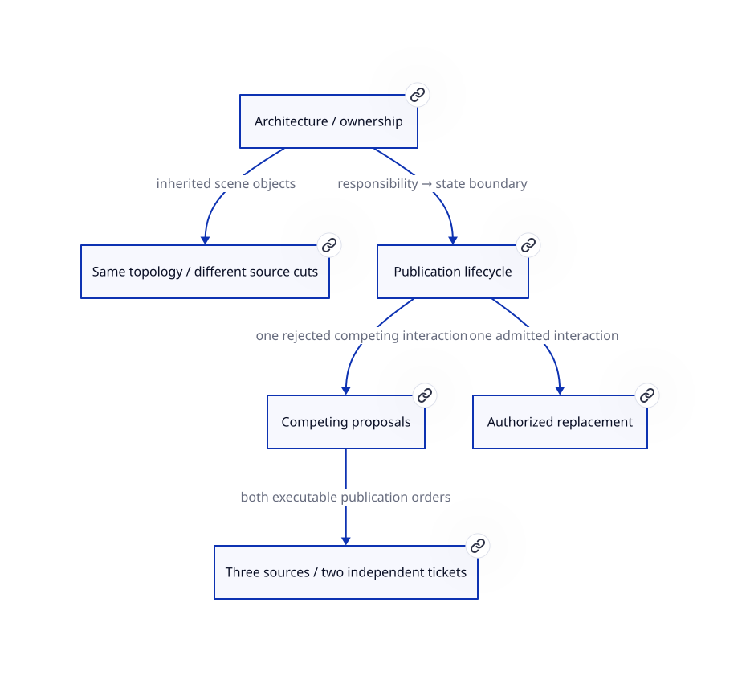
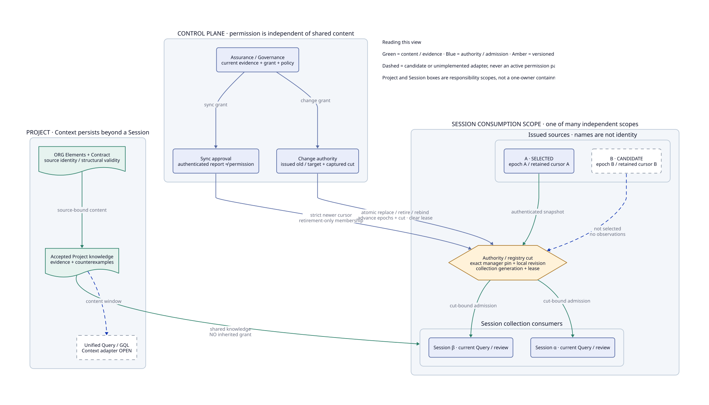
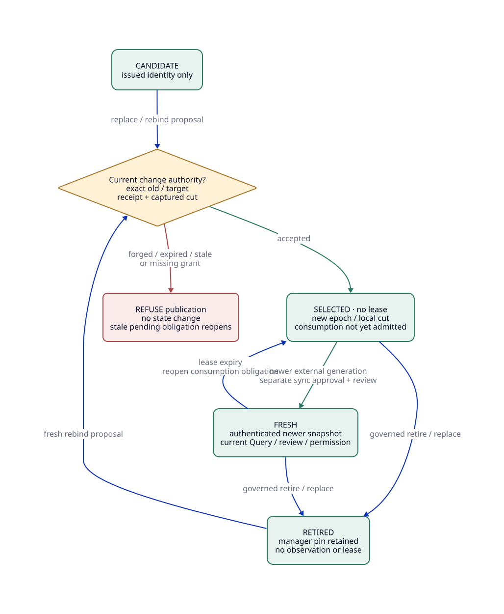
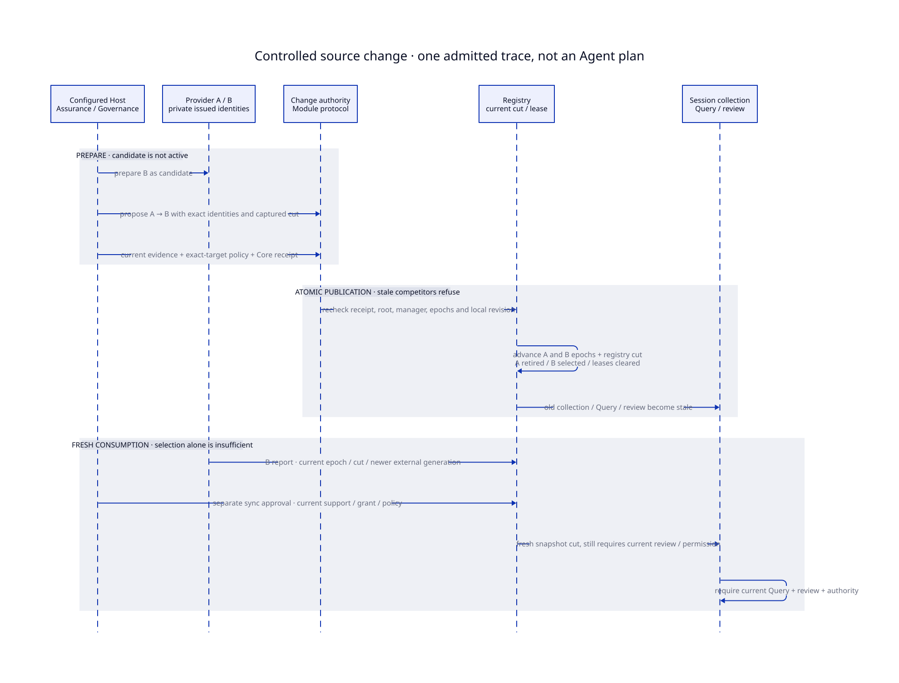
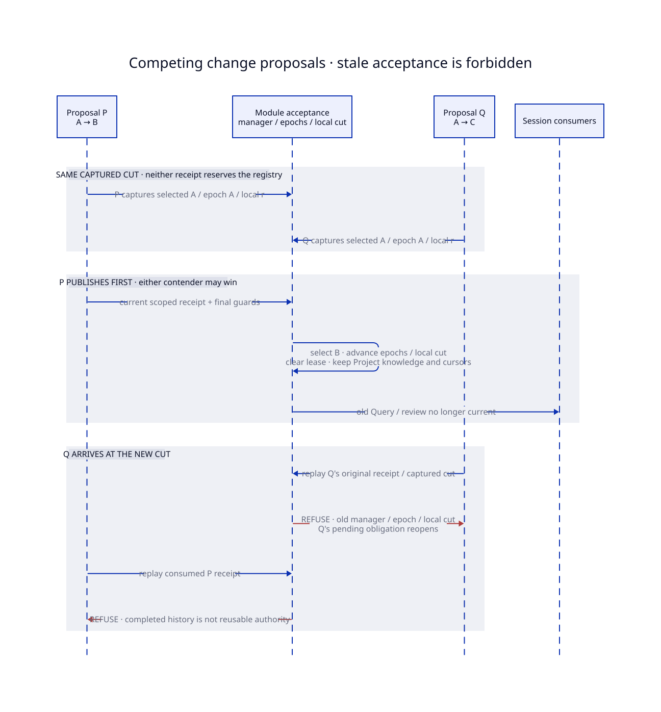
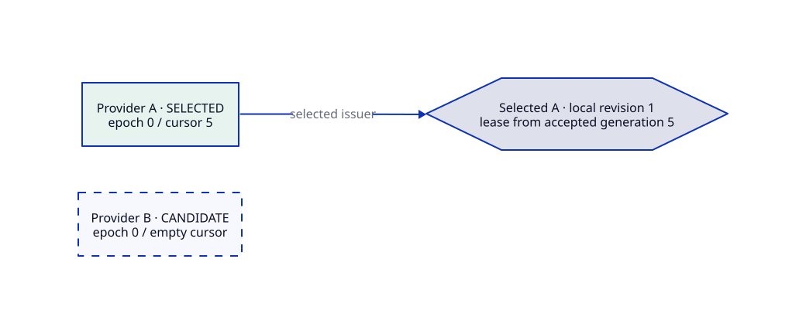
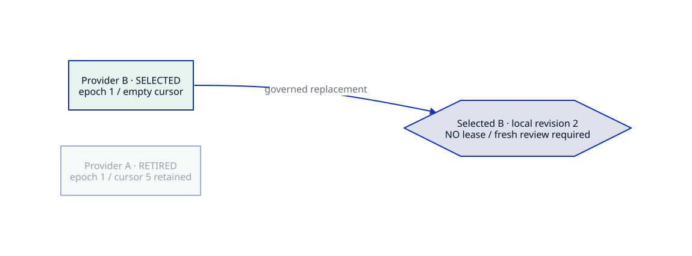
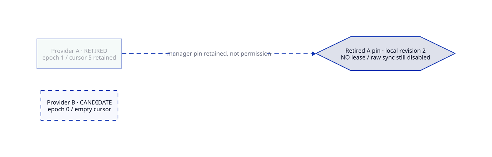
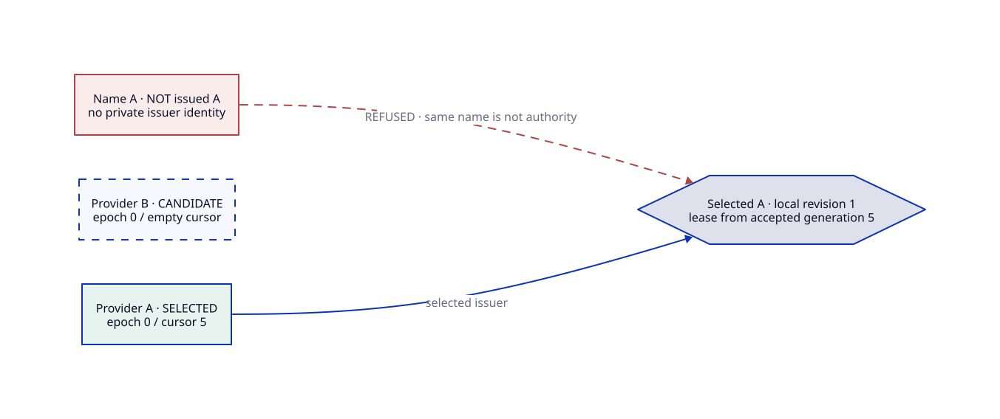

# SPDX-FileCopyrightText: 2026 tao3k team and Contributors
# SPDX-License-Identifier: Apache-2.0 AND LGPL-2.1-or-later
#+title: 10.06.43.41 Controlled Session Source Change — Architecture and Correspondence
:PROPERTIES:
:ID: agentic-ai-lab-context-controlled-session-source-change
:STATUS: module-protocol-composed-views-joint-pass-storage-open
:DATE: 2026-10-15
:END:

* One protocol, different kinds of view

[[file:01-agent-context-lifecycle.org][10.06.43.01]] owns Context, [[file:39-external-session-source-admission.org][39]] owns authenticated Session-source synchronization.
This refinement connects architecture, behavior and conditional laws before
claiming an implementation/verification result. D2 is an inspectable topology
and lifecycle view, not a replacement proof engine or an Agent action script.
Quint explores bounded orderings/negative mutations. LeanPOO proves stated
functional update/preservation laws. Scheme Modules owns actual issuers and
acceptance; Proofs supplies inputs and consumes those Modules.

[[file:41-session-source-change.d2][Composed D2 source]] / . Different
components and relationships need different representations; adding shapes or
edges to one universal graph is not architecture modeling.

| Question | D2 representation | Interpretation boundary |
|----------+-------------------+-------------------------|
| Who owns content, authority and a consumer cut? | Architecture layer: nested responsibility scopes and typed content/control edges | Scope is not a single-owner Session containment tree |
| Which transitions can publish, refuse or reopen? | Lifecycle layer: states, guard diamond and feedback edges | Guards summarize Modules; a diagram does not execute acceptance |
| How do approval, publication and fresh consumption interact? | Accepted-trace layer: sequence participants and grouped phases | One admitted trace, not an Agent action prescription |
| Why can two current proposals not both publish? | Competing-trace layer: same-cut capture, winner and stale refusal | Either contender may win; chronology is a witness, not priority policy |
| What differs on the same source topology? | Source-cuts layer with inherited replacement, retirement and same-name-forgery Scenarios | Scenarios share object identity, not permission or runtime object state |

Each D2 Layer starts with an independent board. Scenarios inherit their base
Layer and alter that view; they do not cumulatively inherit each other. This
matches alternate source cuts better than independently copying full diagrams.
Steps inherit the preceding Step; they are suitable for displaying an observed
execution or a Quint counterexample, not for prescribing exploration. A
machine-bound trace-to-Step exporter is not implemented by this protocol.
See the upstream [[https://d2lang.com/tour/layers/][Layers]], [[https://d2lang.com/tour/scenarios/][Scenarios]] and [[https://d2lang.com/tour/steps/][Steps]] semantics.

[[file:41-session-source-change-topology.d2][Architecture source]] / :

[[file:41-session-source-change-lifecycle.d2][Lifecycle source]] / :

[[file:41-session-source-change-sequence.d2][Accepted interaction source]] / .
[[file:41-session-source-change-race.d2][Competing interaction source]] / .
 and inherited ,
 and  views retain the same A/B/registry topology.

Green content edges do not confer authority; blue control edges do not transfer
Project ownership. Amber marks a guarded version boundary. Dashed candidate/open
edges are not active permission paths. Retained cursors, Project knowledge and
counterexamples must not be mistaken for renewed Query/review/grant validity.

The topology depicts one admissible cut, not permanent selection of provider A.
A Project can contain multiple scopes and Session collections; a managed
authority selects one provider identity at a time. Context is not owned by
that provider or by one Session. Worktree/Session-derived Context continues to
use the existing Project/ORG and C3/C4 composition design; this protocol does
not replace it with a Session containment tree. Generalized runtime composition
and unified Query/GQL adaptation remain separately scoped work. The diagram
marks the Query adapter as open rather than claiming it is implemented.

* Entities, relations and state identity

| Architecture entity / relation | Scheme owner | Quint projection | LeanPOO projection |
|--------------------------------+--------------+------------------+--------------------|
| Project Context and accepted knowledge | Existing Context composition / ORG Elements and Contract | =knowledge= retained independently of live membership | =State.knowledge= preservation |
| Authority manager slot and registry cut | =consumers.ss= private manager pin, local revision and registry generation | =owner=, =revision= | =State.revision= Focus |
| Issued provider identity and lifecycle | =session-source.ss= private issuer; public state diagnosis | Provider indices 0/1, =live= | Truthful issued/slot identity premises, local =State.live= |
| Per-provider binding epoch | =binding-generation= in source state and authenticated event | =epochs.get(provider)=; not one global epoch | =State.epoch= Focus for one affected provider |
| Accepted external generation | Provider-private retained cursor | =cursors= indexed by provider, =floors= preservation monitor | =State.cursor= retained by change |
| Independent administrative approval | Actual Assurance seal/grant, Governance and configured change policy | Current captured ticket plus separate =grant= | =Permit.issued/authorized/bound= are checked premises, not submitted facts |
| Proposal subject and target | Exact issued old/target identities, captured epochs and local revision | Captured old/target epochs and revision | Exact local cut/epoch equality; cross-provider identity checked in Scheme |
| Authenticated observation | Provider, binding epoch, expected local revision, external generation, deadline | =reportOwner/reportEpoch/reportRevision/generation= | =snapshotCurrent=; clock/Host validity remains an explicit premise |
| Consumer admission | Current lease, collection, actual review and permission | =lease/view/admitted= | =admits= cannot follow from rebind alone |

The first draft used one global slot epoch in Quint. The D2 correspondence
review exposed that this hides per-provider identity in A -> B -> A. The model
now indexes epochs and cursors by provider, matching the Module state. Local
revision is a third, separate dimension: equal provider names or equal external
generation numbers never identify the same binding/cut.

Quint's view is a paired current Query/review cut; independent Query/review
issuance remains qualified by the earlier models and real Scheme regression.
Lean's local projection covers one affected provider. It is not another
cross-provider resolver: the bounded two-provider selection lives in Quint,
while actual identity/target checks live in Modules. Lean's natural cursor
uses an order-preserving normalization of Scheme's empty =-1= cursor; it does
not assert equal literal encoding for an unobserved provider.

* Declaration and governed transitions

=org-context-session-source= retains initial trusted-host setup for an unmanaged
authority. It cannot overwrite a managed slot. A replacement is prepared with
=org-context-session-source-candidate=; preparation issues an identity but does
not select it, issue observations or revive any lease. Provider names are only
diagnostic; two prepared providers with the same name are different subjects.

=org-context-session-source-change-authority= is independently configured with
the exact managed scope, current controller binding/Governance, monotone clock
and approval policy. Provider authentication is not administrative authority.
The optional Assurance constructor additionally checks actual Host evidence
and grant before/after policy evaluation. The configured policy must authorize
the exact proposal/target; a matching name cannot substitute for that decision.

The change proposal names the actual old provider and an issued target, or
=#f= for retirement. Authorization issues an actual Core receipt. Commit
rechecks policy, Core receipt, old/target epochs, current manager, captured
local revision and current root/binding, then publishes under provider ->
controller -> installation -> registry locks. The final registry guard checks
the administrative receipt deadline. No Host or external policy operation runs
inside final publication; the trusted leaf clocks must not reenter mutation.

| Operation | Publication and preserved state |
|-----------+---------------------------------|
| Replace A with B | Retire A, select issued B, advance each affected provider epoch once, advance local/registry cut, clear both leases |
| Retire A without target | Retire A, advance its epoch and local/registry cut, keep a non-bypassable manager pin and no live lease |
| Rebind retired A to A | Fresh administrative proposal/receipt, advance A's epoch exactly once and local/registry cut, select A without a lease |
| Rebind retired A to issued B | Same governed checks, advance affected epochs, select B without reviving A |
| Refresh selected source | Fresh authenticated event with current provider epoch/local cut and generation above its retained cursor; separate sync approval advances cut and lease |

Public trusted-host synchronization remains disabled throughout: retiring a
provider does not return the authority to an unmanaged state. Completed change
history remains completed. A competing or old-cut pending proposal reopens
when selection/revision/binding changes. =eligible= is only a candidate; it is
not administrative permission, a review or effect authorization.

Controller-binding replacement stales the administrative authority as well as
provider authentication pinned to that binding. Under a new controller binding,
host configuration must issue a candidate/current administrative authority bound
to that new scope; old provider bindings are not mutated back into authority.
The earlier installation/recovery protocol still owns root replacement.

* Actual replay trace and knowledge retention

The real Scheme consumer uses ORG-derived Context/Contract, real Session objects,
Core-issued receipts and serialized Assurance/Governance objects:

| Local revision | Actual transition | Provider epoch/cursor observation |
|----------------+-------------------+-----------------------------------|
| 0 -> 1 | A accepts authenticated generation 5 | A epoch 0 / cursor 5 |
| 1 -> 2 | Authorized A -> B | A retired epoch 1; B selected epoch 1, no lease |
| 2 -> 3 | B accepts generation 1 and fresh review | B epoch 1 / cursor 1 |
| 3 -> 4 | Authorized B retirement | B retired epoch 2, no live lease |
| 4 -> 5 | Fresh authorized B -> B rebind | B selected epoch 3 / cursor still 1, no lease |
| 5 -> 6 | B accepts generation 2 | Fresh epoch 3 / local cut 5 required |
| 6 -> 7 | Authorized return B -> A | A selected epoch 2 / cursor still 5 |
| 7 -> 8 | A accepts generation 6 and fresh review | Old A epoch 0 / generation 5 / old review cannot revive |

Every change retains the Project composition. Independent Project consumption
is actually reevaluated and stays admitted under its own current source/review/
grant; preservation is not inferred only from an unchanged object reference.
No change transfers another scope's permissions or clears accepted evidence.

Provider retirement differs from Session-member retirement. The authority's
membership upper bound survives a provider change, but previously removed
Session IDs are not reintroduced. Fresh providers can only confirm/remove
members under the existing retirement-only synchronization rule. New membership
requires its own governed protocol, not replay of a pre-retirement snapshot.

* Verification boundary

The D2 sources and rendered SVGs are declared inputs to the complete verifier.
Installed D2 v0.9.0 / Dagre must rerender identical SVG bytes under the bounded
render gate, including all fifteen declared composed boards and four standalone
views. The gate checks the complete board manifest and internal link targets;
a stale or missing board cannot silently accompany changed source. This checks
artifact correspondence, not truth of authorization edges. Visual inspection
also removed accidental nodes caused by unquoted semicolons in the first draft.

Quint explores two issued providers, three administrative changes and external
generations 0/1. Deliberate unsafe mutations must yield actual invariant traces.
LeanPOO supplies conditional Focus, stale-cut, cursor/knowledge and no-renewal
laws without replacing actual Scheme verification or claiming authentication
from a Boolean. Real Scheme additionally checks forged/same-name sources,
actual missing seal/grant, policy withdrawal, consumed/wrong/expired receipts,
old snapshots/epochs/generations, stale controller binding and fresh review.

At the historical [[file:42-session-source-change-verification.org][42]] cut, the competing-interaction drawing's =A -> B= /
=A -> C= was design-only: actual Scheme covered replacement versus retirement,
and the model had one pending ticket. [[file:43-three-source-competition.org][43]] adds actual same-cut P/Q receipts,
both B-first/C-first Module executions, three-provider/two-ticket Quint and
receipt-bound LeanPOO laws. Its inherited D2 competition Scenarios and exact
per-item mapping are qualified separately by [[file:44-three-source-competition-verification.org][44]], not retroactively by 42.
Ordered Module executions and finite interleavings still do not establish OS
lock correctness or arbitrary distributed concurrency.

The current scope is process-local control-plane semantics. Remote signature/
transport/key rotation, durable cursor/epoch persistence, multi-process recovery,
complete Query adaptation, storage executors, bindings and old Memory are not
qualified by these models. [[file:42-session-source-change-verification.org][42 records the executable cut and failures]].
