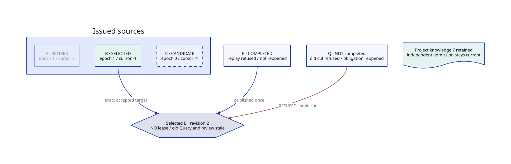
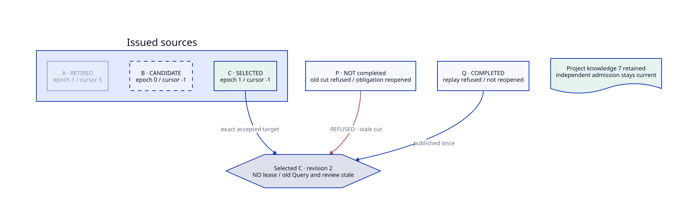
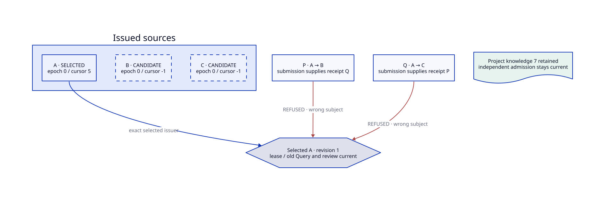
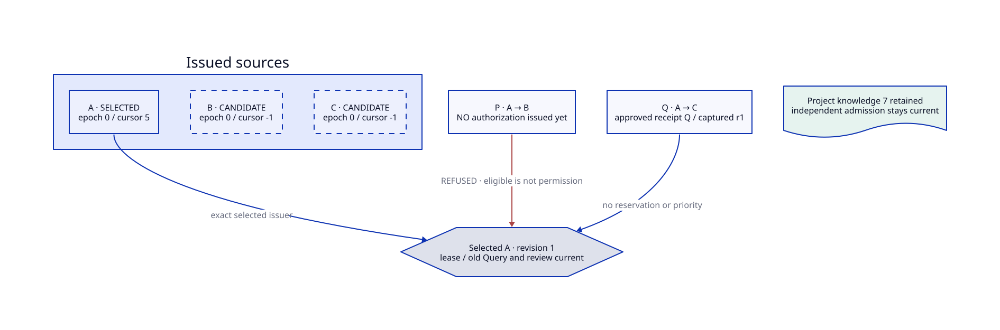

# SPDX-FileCopyrightText: 2026 tao3k team and Contributors
# SPDX-License-Identifier: Apache-2.0 AND LGPL-2.1-or-later
#+title: 10.06.43.43 Three-source Competition — Executable Correspondence
:PROPERTIES:
:ID: agentic-ai-lab-context-three-source-competition
:STATUS: formal-pass-scheme-natural-exit-open
:DATE: 2026-10-15
:END:

* Semantic owner and real input

[[file:01-agent-context-lifecycle.org][10.06.43.01]] owns Context; [[file:41-controlled-session-source-change.org][41]] owns controlled provider change. The
existing [[file:../../../../modules/ai-agentic-context/session-source-change.ss][Module protocol]] already admits an issued target independently of its
display name. This Case does not add a proof-side arbiter or change that protocol.
Proofs supplies three issued sources and consumes actual proposal/authorization/
commit/evaluation functions. Storage executors, bindings and old Memory are unchanged.

The real [[file:../../../../packages/proofs/context-lifecycle/provider-competition-controls.ss][Scheme replay]] derives Context from the existing parsed ORG Elements
and executed Contract fixture. A real Session object scopes the collection;
actual Assurance evidence/grants, Governance, source binding and Core verifier
serve both tickets. A, B and C have the same display name but different private
issuer/capability identities. Initially A accepts external generation 5 at local
revision 1; B/C are candidates with epoch 0 and empty cursor =-1=.

P proposes =A -> B=; Q proposes =A -> C=. Both are prepared and authorized
before either commit, each capturing local revision 1 and source/target epochs 0.
Issuing a receipt neither reserves the registry nor prioritizes its proposal.

* Two executable publication orders

| Field | P publishes first | Q publishes first |
|-------+-------------------+-------------------|
| Accepted target | B selected | C selected |
| Local revision after both submissions | 2 | 2 |
| A | Retired, epoch 1, cursor 5 | Retired, epoch 1, cursor 5 |
| B | Selected, epoch 1, cursor -1 | Candidate, epoch 0, cursor -1 |
| C | Candidate, epoch 0, cursor -1 | Selected, epoch 1, cursor -1 |
| Winning proposal | Completed; replay refuses; history not reopened | Completed; replay refuses; history not reopened |
| Losing proposal | Q old-cut commit refuses; pending obligation reopens | P old-cut commit refuses; pending obligation reopens |
| Prior collection / Query / review | Stale; no restored lease | Stale; no restored lease |
| Project Context | Same composition; independent actual admission remains true | Same composition; independent actual admission remains true |

After either order, only the selected source can authenticate a new report at
its new epoch and local cut. Its generation 0 is strictly newer than its own
empty cursor; it does not inherit A's cursor 5. Separate sync approval advances
local revision to 3. A fresh Query/review is admitted; the old review and losing
change receipt still refuse. Wrong-target credentials cannot authenticate the
selected source even though every display name is identical.

These are real ordered Module executions, not simultaneous OS-thread races.
The bounded Quint model explores both two-proposal publication orders and their
prepare/approve/refuse/refresh interleavings. Neither proves OS lock correctness,
remote authentication, crash persistence or arbitrary distributed delivery.

* Per-item correspondence

[[file:41-session-source-change.d2][The composed D2 source]] adds an inherited three-source base and five Scenarios:
, , , ,  and .
They are views of the following executable obligations, not a second evaluator.
The diagram's knowledge value 7 is the formal projection's preservation token,
not a claim that the real Project contains seven records. Actual Scheme checks
independent admission and retained composition rather than a synthetic count.

| D2 scene / observation | Quint Case or invariant | LeanPOO property | Real Scheme observation under =provider-competition/{b-first,c-first}/= |
|------------------------+-------------------------+------------------+------------------------------------------------------------------------|
| Base: independent P/Q issued/approved at the same cut | =prepared=, =approved= | =acceptedCurrent= prerequisites | =both-receipts-issued=, =both-eligible-before-publication=, =eligible-does-not-authorize= |
| B-first accepted | =b-first=, =OneWinner=, =ExactTarget= | =exactTarget=, =advancesCut=; B guard | =winner-publishes=, =exact-winner-selected= in =b-first= |
| C-first accepted | =c-first=, =OneWinner=, =ExactTarget= | Same laws; C guard | Same observations in =c-first= |
| Losing receipt refuses and reopens | =reopened=; double-publication mutation violates =OneWinner= | =competingTicketRefused=, =competingReceiptRefused= | =loser-old-cut-refused=, =loser-obligation-reopens=, =loser-not-completed= |
| Winning receipt cannot replay; history retained | =replay=, =Completed=; winner-reopen mutation | =consumedTicketRefused= | =winner-replay-refused=, =winner-history-completed=, =winner-history-not-reopened= |
| Swapped P/Q receipt refuses, state unchanged | =swapped-refused=; target-substitution mutation violates =ExactTarget= | =swappedTargetReceiptRefused= | =p-receipt-cannot-authorize-q=, =q-receipt-cannot-authorize-p=, =both-still-eligible-after-wrong-receipt= |
| Authorization not issued yet | =unapproved-refused= | =unapprovedRefused=, =missingReceiptRefused= | =p-unapproved-before-issuance-refused=; Q already issued, P not yet issued |
| Issued approval omitted at submission | =missing-supplied-receipt= | =missingReceiptRefused= | =issued-but-missing-submitted-receipt-refused=, =refused-submissions-preserve-source-cut=; both receipts already issued |
| Only A and the selected target advance epoch | =EpochIsolation=; third-epoch mutation | =affectedEpochAdvanced=, =thirdEpochRetained= | =a-epoch-advanced-once=, =winner-epoch-advanced-once=, =loser-epoch-untouched= |
| Per-provider cursors and Project knowledge survive | =Cursors=, =Knowledge= and their unsafe mutations | =cursorsRetained=, =knowledgeRetained= | =a-cursor-retained=, =loser-cursor-untouched=, =project-still-admitted=, =composition-retained= |
| Replacement is not review/admission | =Admission=; old-review mutation | =noLeaseRenewal= | =replacement-not-a-live-lease=, =old-query-stale=, =old-review-obligation-reopens= |
| Fresh selected source and review can consume | =fresh= under =Renew/ReviewConsume= | No-lease law distinguishes publication from later independent admission | =fresh-winner-snapshot=, =fresh-query-current=, =fresh-winner-review-admitted=, =old-review-not-revived= |

[[file:../../../../packages/proofs/context-lifecycle/ContextProviderCompetition.qnt][Quint Case]] suffixes above use =provider-competition-=. It has three providers,
two independent immutable-target ticket slots and one winning change; a later
refresh/review is explicitly separated. =RefuseSwappedReceipt= is the abstract
subject-mismatch refusal event; the real Core subject binding is exercised in
Scheme. A separate =RefuseMissingReceipt= event occurs after both approvals
exist, whereas =Refuse= before approval witnesses an unapproved proposal.
Issuance and supplying a valid receipt are not conflated. The safe model
exhausts 229 distinct states (461 generated). Seven
deliberately unsafe mutations must produce actual invariant counterexamples;
ten reachability controls prevent vacuous safe success. There are 18 Cases.

[[file:../../../../packages/proofs/lean-poo/AgenticAILabContextLifecycleProof/ProviderCompetition.lean][LeanPOO's competition projection]] uses a lawful revision Focus and finite
provider identities, with separate per-provider epochs and cursors. Seventeen
conditional theorems and thirteen executable guards distinguish publish from
receipt-checked acceptance. A receipt's validity is the actual verifier premise,
not a caller-set Boolean authorization API. Structural subject equality projects
the issued ticket identity; the theorem does not prove private Scheme issuance
or cryptography. Cursor normalization maps Scheme =-1/5= to Lean =0/6= and
preserves order; the concrete encodings are not claimed identical.

The Scheme verifier checks real Core/Assurance objects, not those Lean premises
as submitted facts. It runs 44 observations per publication order (88 total).
The prior replacement/retirement, recovery, source authentication and ASCENT
relation suites remain required; this Case does not replace them.
All 790 Scheme assertions completed, but the latest full gate failed during
natural process shutdown under the unchanged five-second silence watchdog.
This is not a full Scheme/joint pass; [[file:44-three-source-competition-verification.org][44]] retains the failure and shutdown sample.

* Module acceptance boundary

=session-source-change.ss= owns private proposal identity, exact old/target
rows, captured old/target epochs and local revision, current root/binding,
Governance, policy and receipt validation. =consumers.ss= owns the final manager
and revision check/publication under the registry mutex. =session-source.ss=
owns issued provider status, authentication, cursor and lease. The optional
Assurance adapter supplies actual evidence/grant checks, not another arbiter.
Both ordered executions use those same functions without a proof-owned update.

Diagram source/SVG parity, exact fifteen-board inventory and internal links are
part of the unchanged bounded joint gate. They establish artifact consistency,
not semantic equivalence by themselves. [[file:44-three-source-competition-verification.org][44 records final evidence and identities]].
